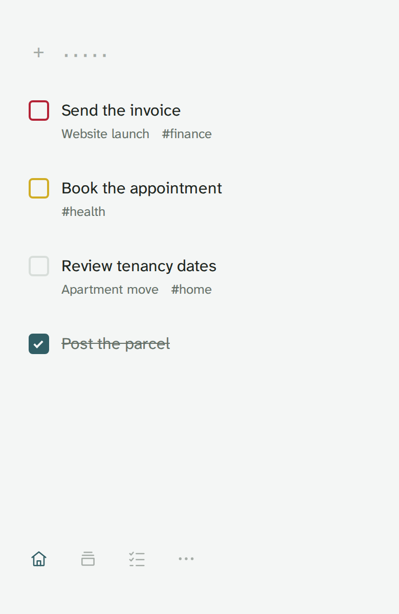
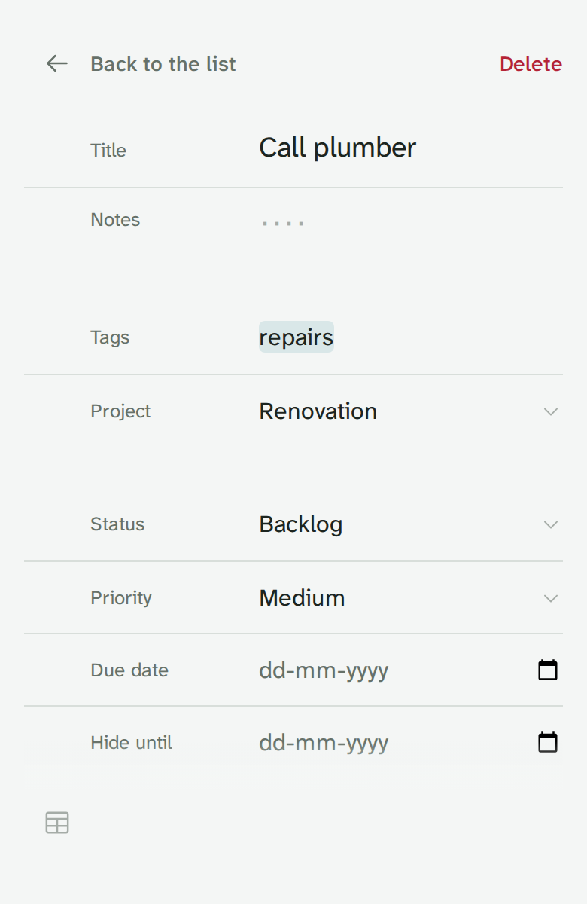
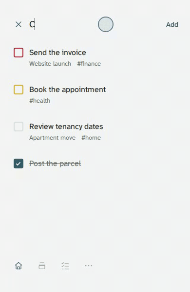
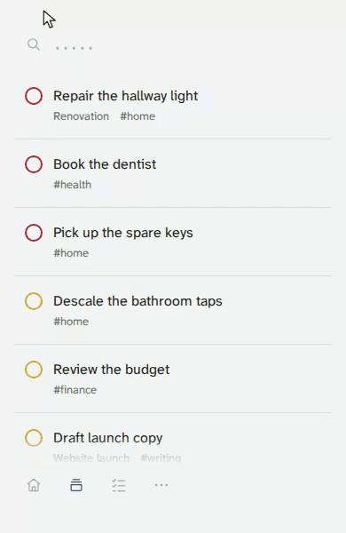

# only-tdy

Capture tasks quickly, choose what matters today, and leave the rest in Backlog.

only-tdy makes organizing todos approachable through a minimalist, distraction-free daily flow. Pick tasks from Backlog, work through Today, and edit details without leaving that flow.

<p>
  
  
</p>
<br clear="all">
<br>

## See it in action

The unobtrusive bar stays quiet until you focus it. The same field supports quick task entry and search, with grammar and auto-completion for projects, tags, priorities and dates. The in-app Guide explains the grammar.

Add a task to Backlog quickly using the parser and auto-completion for a project, priority, due date and tag.



Filter Backlog by tag, select tasks across priorities, move them to Today, then search for a moved task.



Try `Call plumber +Renovation #repairs !3 /today`; omit `/today` to leave an undated task in Backlog. Use `/due:tomorrow` or `/hide:+3` for dates, or edit dates and notes in the task editor. A new project name can create a project. Switch the empty bar between capture and search; search one phrase, tag, project or priority at a time.

## Try it locally

Install [mise](https://mise.jdx.dev), then:

```sh
git clone https://github.com/Muatasim-Aswad/only-tdy.git
cd only-tdy
mise install
mise exec -- pnpm install --frozen-lockfile
mise run dev:seeded
```

Open the `/only-tdy/` URL printed by the server. The seeded demo needs no Tududi installation: it uses synthetic data, supports edits, and forgets changes when the server stops. It is excluded from production builds.

## Use with your tasks

A current Tududi installation providing the expected `/api/` session, CSRF, profile, task, project, tag and search endpoints is required for real data. Serve only-tdy at `/only-tdy/` on the **same HTTPS origin** as Tududi and sign in through Tududi. Tududi owns your tasks and remains available as an optional fuller UI for complex planning. Use the [published Docker image](docs/deployment.md#published-image) or [build from source](docs/deployment.md#build-from-source) with the same Compose file. See [deployment](docs/deployment.md) and [API compatibility limits](docs/limitations.md#compatibility).

This is an unofficial integration, unaffiliated with Tududi. Upstream API changes may break it; use it in accordance with Tududi's license and applicable service terms. No real-backend version is currently verified.

- Automatic promotion of existing due tasks is an explicit opt-in setting, off by default.
- Install as a PWA where your browser supports it. The shell can reopen offline after a successful online visit; task loading and saving require a connection.

## Coverage and development

Verification covers Chromium on Linux, including narrow layouts, keyboard interaction, themes, reduced motion and forced colors. Firefox, WebKit/Safari, real mobile devices and their installation flows are unverified; viewport tests do not establish device support.

See [contributing](CONTRIBUTING.md#setup-and-checks) for setup and the shared local/CI gate, and [releases](docs/releases.md) for deterministic release rehearsals.

Read [architecture](docs/architecture.md) for ownership and planning rules, [limitations](docs/limitations.md) for data handling and recovery, [security](SECURITY.md) for vulnerability reporting, and [the changelog](CHANGELOG.md) for release changes. Ask questions in [Discussions](https://github.com/Muatasim-Aswad/only-tdy/discussions).

Licensed under [MIT](LICENSE). Bundled asset attribution is in [third-party notices](THIRD_PARTY_NOTICES.md).
